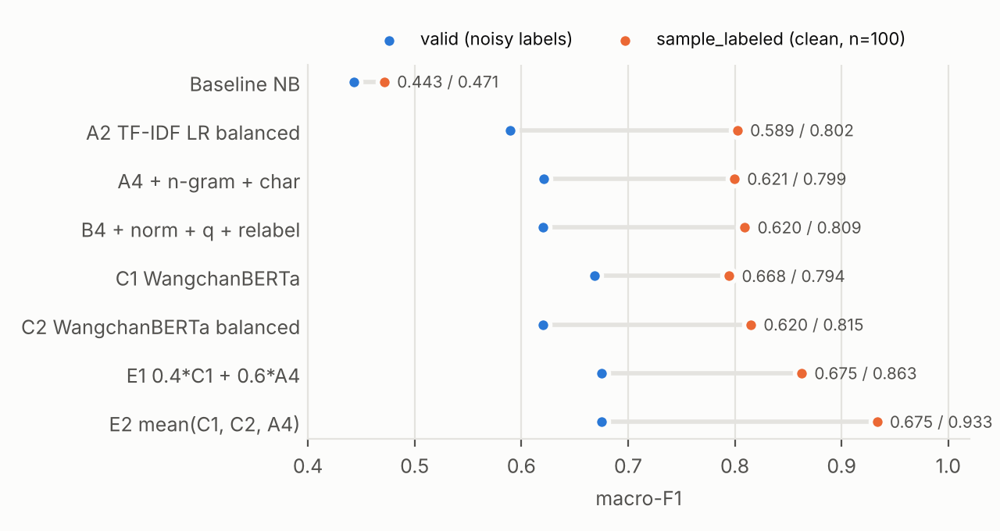
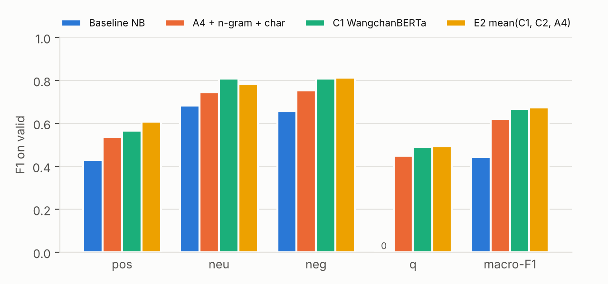

# EGCO461 Project: Thai Sentiment Classification (กลุ่ม G66)

> **ร่างรายงาน** ตัวเลขทั้งหมดมาจาก `results/*.csv` กราฟสร้างด้วย `python code/make_figures.py`
> หัวข้อ 6 อยู่ในไฟล์แยก `report/error_analysis.md`
> ส่วนที่ต้องกรอกเองมีเครื่องหมาย **[TODO]**

## 1. สมาชิกและการแบ่งงาน

| ชื่อ–สกุล | รหัสนักศึกษา | งานที่รับผิดชอบ |
|---|---|---|
| [TODO] | [TODO] | [TODO] เช่น แนวทาง A/B, การสำรวจข้อมูล |
| [TODO] | [TODO] | [TODO] เช่น fine-tune WangchanBERTa บน Colab |
| [TODO] | [TODO] | [TODO] เช่น error analysis, ติด label ตรวจ valid |
| [TODO] | [TODO] | [TODO] เช่น รายงาน, README, ตรวจไฟล์ส่ง |

## 2. สิ่งที่พบจากการสำรวจข้อมูล

**ความไม่สมดุลของคลาส** train และ valid มีสัดส่วนเท่ากันเพราะแบ่งตามสัดส่วนคลาส แต่ sample_labeled ซึ่งมีลักษณะเหมือน test มีคลาส `q` มากกว่าประมาณสองเท่า

| คลาส | train (24,020) | valid (2,669) | sample_labeled (100) |
|---|---|---|---|
| neu | 54.5% | 54.6% | 48% |
| neg | 25.6% | 25.6% | 26% |
| pos | 17.8% | 17.8% | 21% |
| q | 2.1% | 2.1% | 5% |

คลาส `q` มีแค่ 498 ข้อความใน train baseline Naive Bayes จึงไม่ทาย `q` เลย (F1 = 0) เพราะ prior ของคลาสต่ำเกินไป เป็นเหตุผลที่เราใช้ class weight และติดตาม F1 ของ `q` แยกในทุกการทดลอง

**ความยาวข้อความ** test และ sample_labeled สั้นกว่า train มาก (นับจำนวนตัวอักษรเท่านั้น ไม่ได้ใช้ข้อความ test ในการ train หรือเลือกโมเดล)

| | median | mean | percentile 95 |
|---|---|---|---|
| train | 39 | 90 | 331 |
| valid | 40 | 86 | 300 |
| sample_labeled | 29 | 31 | 52 |
| test | 30 | 32 | 61 |

ใน train ข้อความ `neg` ยาวที่สุด (median 60 ตัวอักษร) และ `pos` สั้นที่สุด (median 23) ข้อความสั้นใน test จึงมีบริบทน้อยกว่าที่โมเดลเห็นตอน train การตั้ง max length 128 token สำหรับ WangchanBERTa จึงเพียงพอ (ใน train มีข้อความยาวเกินและถูกตัดประมาณ 3%)

**ลักษณะของข้อความโซเชียล** ใน train มีตัวอักษรซ้ำ 3 ตัวขึ้นไป (เช่น มากกกก) 25.6% มีเสียงหัวเราะ 555 อยู่ 7.4% และมีลิงก์ 2.4% นอกจากนี้ยังมีสแลง คำผิด อีโมจิ และแฮชแท็ก ซึ่งเป็นที่มาของการ normalize ข้อความในแนวทาง B

**Label noise** ตามที่โจทย์เตือนไว้ คำถามขอข้อมูลสินค้าหลายข้อความใน train และ valid ถูกติดเป็น `neu` เช่น "ขอรายละเอียด honda civic หน่อยครับ" และ "อยากได้ค่ะ หาซื้อได้ที่ไหนคะ" จากการตรวจข้อที่โมเดลทายผิด 50 ข้อใน valid พบว่า 52% ของข้อผิดมาจาก label ที่ไม่ตรงนิยาม (รายละเอียดในหัวข้อ 6.3) เราจึงใช้ sample_labeled เป็นตัวตรวจสอบประกอบ valid เสมอ

## 3. วิธีการ

**การเลือกโมเดล**
- ภายในแต่ละแนวทาง เลือก config ด้วย **macro-F1 บน valid** เท่านั้น
- sample_labeled ใช้ดูแนวโน้มว่าโมเดลใช้กับข้อมูลแบบ test ได้หรือไม่ ไม่ได้ใช้ปรับค่า
- ไม่ได้ใช้ข้อความ test ในการ train ปรับ hyperparameter หรือเลือกโมเดล
- โมเดลสุดท้ายของแนวทาง A และ B train ใหม่บน train+valid ส่วน WangchanBERTa train บน train อย่างเดียว

**การเตรียมข้อความและตัดคำ**
- ตัดคำด้วย PyThaiNLP `newmm` เหมือน baseline
- แนวทาง B เพิ่มการ normalize: ตัดตัวอักษรที่ซ้ำ 3 ตัวขึ้นไปให้เหลือตัวเดียว, แทน 555 / ลิงก์ / ตัวเลขด้วย token พิเศษ (`xlaugh`, `xurl`, `xnum`), แยกอีโมจิเป็น token ของตัวเอง และใช้ `pythainlp.util.normalize`
- WangchanBERTa ใช้ SentencePiece tokenizer ของโมเดลเอง แปลงช่องว่างเป็น `<_>` และตัวพิมพ์เล็ก ตามแบบที่โมเดลใช้ตอน pretrain

**แนวทาง A: TF-IDF + โมเดลเชิงเส้น** (ablation ทีละขั้น)
- feature: TF-IDF แบบ sublinear, min_df = 2, word n-gram (1,2) รวมกับ character n-gram (`char_wb`, 2–4)
- โมเดล: Logistic Regression (C = 1, `class_weight='balanced'`) เทียบกับ LinearSVC และลองค่า C หลายค่า

**แนวทาง B: normalize + จัดการคลาส q + label noise** (ต่อยอดจาก A4)
- B2: feature คำถามที่เขียนเอง 6 ตัว ได้แก่ คำลงท้ายคำถาม, คำแสดงคำถาม (เท่าไหร่, ที่ไหน), เครื่องหมาย ?, คำขอข้อมูล (ราคา, สาขา, โปร), คำลงท้ายสุภาพ และตัวที่รวมรูปคำถามกับคำขอข้อมูล
- B3: คูณน้ำหนักให้ความน่าจะเป็นของ `q` โดยหาค่าจาก 3-fold CV บน **train** (valid ไม่ถูกใช้)
- B4: แก้ label ใน train ที่โมเดล CV ทายต่างจาก label ด้วยความมั่นใจ ≥ 0.9 พบ 181 แถว ส่วนใหญ่เป็น `neu` ที่โมเดลเห็นว่าเป็น `q` (64), `neg` (48) หรือ `pos` (42)

**แนวทาง C: fine-tune WangchanBERTa** (`airesearch/wangchanberta-base-att-spm-uncased`)
- AdamW, learning rate 3e-5, batch 32, 3 epochs, warmup 10%, weight decay 0.01, fp16, max length 128
- train บน Google Colab T4 ประมาณ 2.5 นาทีต่อ epoch เลือก epoch ที่ macro-F1 บน valid ดีที่สุด
- C1 ใช้ cross-entropy ปกติ C2 ใส่ class weight แบบ balanced ใน loss

**Ensemble** เฉลี่ยความน่าจะเป็นของแต่ละคลาส
- E1 = 0.4 × C1 + 0.6 × A4 โดยหาน้ำหนักจาก valid (grid 0.0–1.0)
- E2 = ค่าเฉลี่ยของ C1, C2 และ A4 ไม่ได้ปรับค่าใดๆ

## 4. ผลการทดลอง

**ตาราง 3** macro-F1 และ F1 รายคลาส บน valid และ sample_labeled

| โมเดล | valid macro | pos | neu | neg | q | sample macro | pos | neu | neg | q |
|---|---|---|---|---|---|---|---|---|---|---|
| Baseline: count + NB | **0.443** | 0.431 | 0.683 | 0.657 | 0.000 | **0.471** | 0.595 | 0.644 | 0.647 | 0.000 |
| A1: TF-IDF + LR | **0.532** | 0.453 | 0.792 | 0.733 | 0.151 | **0.472** | 0.606 | 0.723 | 0.558 | 0.000 |
| A2: A1 + class_weight balanced | **0.589** | 0.542 | 0.717 | 0.738 | 0.360 | **0.802** | 0.723 | 0.736 | 0.750 | 1.000 |
| A3: A2 + word 1-2 gram | **0.605** | 0.543 | 0.727 | 0.745 | 0.406 | **0.806** | 0.718 | 0.804 | 0.704 | 1.000 |
| **A4: A3 + char 2-4 gram** | **0.621** | 0.538 | 0.745 | 0.753 | 0.449 | **0.799** | 0.750 | 0.828 | 0.731 | 0.889 |
| A5: A4 features + LinearSVC | **0.593** | 0.517 | 0.772 | 0.739 | 0.346 | **0.560** | 0.619 | 0.741 | 0.545 | 0.333 |
| B1: A4 + normalization | **0.616** | 0.534 | 0.744 | 0.755 | 0.430 | **0.809** | 0.780 | 0.837 | 0.731 | 0.889 |
| B2: B1 + question features | **0.605** | 0.538 | 0.743 | 0.752 | 0.388 | **0.809** | 0.780 | 0.837 | 0.731 | 0.889 |
| B3: B2 + q weight (CV) | **0.616** | 0.540 | 0.745 | 0.752 | 0.428 | **0.809** | 0.780 | 0.837 | 0.731 | 0.889 |
| B4: B3 + relabel noise | **0.620** | 0.546 | 0.747 | 0.749 | 0.438 | **0.809** | 0.780 | 0.837 | 0.731 | 0.889 |
| **C1: WangchanBERTa** | **0.668** | 0.567 | 0.810 | 0.809 | 0.488 | **0.794** | 0.889 | 0.878 | 0.840 | 0.571 |
| C2: C1 + class weight balanced | **0.620** | 0.576 | 0.690 | 0.796 | 0.419 | **0.815** | 0.800 | 0.805 | 0.821 | 0.833 |
| E1: 0.4×C1 + 0.6×A4 | **0.675** | 0.612 | 0.803 | 0.808 | 0.475 | **0.863** | 0.952 | 0.896 | 0.852 | 0.750 |
| **E2: mean(C1, C2, A4)** | **0.675** | 0.608 | 0.784 | 0.813 | 0.494 | **0.933** | 0.909 | 0.935 | 0.889 | 1.000 |

ค่า C อื่นที่ลองใน A (valid / sample): LR C = 0.3: 0.606 / 0.830, C = 3: 0.609 / 0.769, C = 10: 0.600 / 0.644; SVC C = 0.1: 0.608 / 0.771, C = 0.3: 0.621 / 0.659 ไม่มีค่าไหนชนะ A4 บน valid
หมายเหตุ: baseline ในตารางนี้ได้ 0.443 บน valid ต่างจาก 0.446 ในเครื่องอื่นเล็กน้อย เพราะเวอร์ชันของ PyThaiNLP ต่างกัน ทุกแถวในตารางรันในเครื่องเดียวกัน

**รูป 1** macro-F1 บน valid (label มี noise) เทียบกับ sample_labeled (label ตามนิยาม, 100 ข้อ) ของแต่ละโมเดล

**รูป 2** F1 รายคลาสบน valid ของ baseline, A4, C1 และ E2

**สิ่งที่ช่วยจริง เรียงตามขนาดผล**
1. **class weight สำหรับโมเดลเชิงเส้น (A1 → A2): +0.057 บน valid และ +0.33 บน sample** baseline และ A1 แทบไม่ทาย `q` เลย การถ่วงน้ำหนักให้คลาสเล็กทำให้ F1 ของ `q` ขึ้นจาก 0.15 เป็น 0.36 บน valid เป็นการเปลี่ยนแปลงที่ได้ผลมากที่สุดเมื่อเทียบกับต้นทุน
2. **pretrained model (A4 → C1): +0.047 บน valid** ดีขึ้นทุกคลาส เพราะ WangchanBERTa เข้าใจบริบทของประโยค ไม่ได้ดูแค่คำ (ดูหัวข้อ 6.4)
3. **ensemble (C1 → E2): +0.007 บน valid และ +0.14 บน sample** A4 กับ C1 ผิดคนละข้อกัน (หัวข้อ 6.5) การเฉลี่ยจึงแก้ข้อผิดของกันและกันได้
4. **n-gram และ char n-gram (A2 → A4): +0.032 บน valid** char n-gram ช่วยเรื่องคำสะกดผิดและคำที่ตัดผิด

**สิ่งที่ไม่ช่วย และเพราะอะไร**
- **แนวทาง B ไม่ชนะ A4 บน valid** (0.605–0.620 เทียบกับ 0.621) และได้ sample เท่ากันทุกขั้นที่ 0.809 คือทายต่างกันไม่ถึงหนึ่งข้อจาก 100
  - feature คำถาม (B2) ทำให้ F1 ของ `q` บน valid ลดลง เพราะ valid ติดคำถามเป็น `neu` แบบเดียวกับ train การทาย `q` ตามนิยามมากขึ้นจึงถูกนับว่าผิด
  - CV บน train แนะนำให้ **ลด** น้ำหนักของ `q` (0.75) ด้วยเหตุผลเดียวกัน ขัดกับข้อมูลในโจทย์ที่บอกว่า test มี `q` มากกว่า train
  - **ข้อสรุปของแนวทาง B:** การแก้ label noise วัดผลด้วย valid ไม่ได้ เพราะ valid มี noise แบบเดียวกัน และ sample มี `q` แค่ 5 ข้อ น้อยเกินกว่าจะแยกความต่างได้
- **class weight สำหรับ BERT (C1 → C2): −0.048 บน valid** ตรงข้ามกับโมเดลเชิงเส้น BERT แยกคลาสได้ดีอยู่แล้ว การถ่วงน้ำหนักทำให้ทาย `pos` และ `q` มากเกินไป F1 ของ `neu` จึงลดลงจาก 0.81 เป็น 0.69 แต่ C2 ได้ sample สูงกว่าและทาย `q` ได้มากกว่า จึงยังมีประโยชน์ในฐานะส่วนหนึ่งของ E2
- **LinearSVC (A5)** ได้ valid ใกล้กับ LR แต่ sample ตกเหลือ 0.56 เป็นตัวอย่างว่าโมเดลที่ได้ valid ใกล้กันอาจทำงานกับข้อมูลแบบ test ได้ต่างกันมาก

**ความไม่แน่นอนของคะแนน sample** ช่วงความเชื่อมั่น 95% จาก bootstrap 2,000 รอบของ macro-F1 บน sample ได้แก่ A4 [0.66, 0.88], C1 [0.63, 0.92], E1 [0.68, 0.95] และ E2 [0.88, 0.98] ช่วงกว้างเพราะมีแค่ 100 ข้อ และ `q` มีแค่ 5 ข้อ ผลบน sample จึงใช้ยืนยันทิศทางได้ แต่ใช้เลือกระหว่างโมเดลที่ต่างกันเล็กน้อยไม่ได้

## 5. ไฟล์ที่ส่ง (5 ไฟล์)

| ไฟล์ | โมเดล | valid | sample | สัดส่วน q ที่ทายบน test | เหตุผลที่เลือกส่ง |
|---|---|---|---|---|---|
| `G66_run1_e2_bert2_tfidf.csv` | E2: mean(C1, C2, A4) | 0.675 | 0.933 | 4.6% | **ตัวหลัก** valid สูงสุด (เท่ากับ E1) แต่ไม่ได้ปรับค่าใดๆ บน valid, sample สูงสุด, และสัดส่วน q ใกล้ประมาณ 5% ที่โจทย์บอกที่สุด |
| `G66_run2_e1_bert_tfidf.csv` | E1: 0.4×C1 + 0.6×A4 | 0.675 | 0.863 | 3.2% | ensemble แบบมีน้ำหนักจาก valid ไว้เทียบกับ E2 ว่าการใส่ C2 ช่วยจริงไหม |
| `G66_run3_wangchanberta.csv` | C1: WangchanBERTa | 0.668 | 0.794 | 1.7% | โมเดลเดี่ยวที่ดีที่สุดบน valid ไว้วัดว่า ensemble ช่วยแค่ไหนบน test |
| `G66_run4_tfidf_lr.csv` | A4: TF-IDF + LR | 0.621 | 0.799 | 4.0% | ดีที่สุดของแนวทางคลาสสิก รันบน CPU ได้ในไม่กี่นาที |
| `G66_run5_b4_norm_q.csv` | B4: A4 + normalize + q + relabel | 0.620 | 0.809 | 3.9% | วัดว่าการแก้ label noise ช่วยบน test ซึ่งติด label ตามนิยามหรือไม่ ซึ่ง valid วัดไม่ได้ |

ไฟล์ทั้ง 5 ตรวจรูปแบบเทียบกับ `sample_submission.csv` แล้ว ทุกไฟล์มีคอลัมน์ `id,category` ครบ 1,577 แถว และใช้แค่ 4 label

**คะแนน test ที่คาด (E2): macro-F1 ประมาณ [TODO: เลือกค่า เช่น 0.82]** มีเหตุผลสามข้อ
- test ติด label ตามนิยามเหมือน sample ซึ่ง E2 ได้ 0.933 (ช่วง bootstrap 0.88–0.98)
- accuracy บน valid เมื่อปรับแก้ label noise จะอยู่ที่ประมาณ 86% (หัวข้อ 6.3) ซึ่งสอดคล้องกัน
- แต่เราคาดว่า test จะต่ำกว่า sample เพราะ (1) sample มี `q` แค่ 5 ข้อ ส่วน test มีประมาณ 79 ข้อ และ `q` เป็นคลาสที่ยากที่สุด (F1 บน valid 0.49) และ (2) test เป็นข้อความชุดใหม่ที่ไม่ได้มาจาก Wisesight

## 6. Error analysis

ดู `report/error_analysis.md`

## 7. การใช้เครื่องมือ AI ช่วยทำงาน

ใช้ Claude Code (Anthropic) ช่วยในงานต่อไปนี้
- **เขียนโค้ด:** สคริปต์ของแนวทาง A และ B, notebook ของ WangchanBERTa, ensemble, ตาราง error analysis และกราฟ ทุกสคริปต์ใช้ฟังก์ชันวัดผลกลางชุดเดียวกัน
- **ร่างรายงาน:** ร่างหัวข้อ 2–7 จากผลที่ได้ กลุ่มตรวจและแก้ไขเอง
- **ตรวจความสอดคล้องของ error analysis:** AI ชี้แถวที่การกรอกขัดกันเอง (note บอกว่าโมเดลถูก แต่กรอกว่า label ถูก) กลุ่มตัดสินใจแก้เอง

สิ่งที่กลุ่มทำเอง: รัน WangchanBERTa บน Colab, ตรวจ label และจัดกลุ่มสาเหตุของข้อผิด 50 ข้อใน valid, ตัดสินใจเลือกไฟล์ส่ง และ [TODO: เพิ่มเติม]

**การปฏิบัติตามกติกา:** ไฟล์ทำนายทุกไฟล์มาจากโมเดลที่กลุ่ม train เอง ไม่ได้ส่งข้อความ test ให้ AI ทำนายหรือติด label ข้อความ test ถูกส่งผ่านโมเดลของเราเท่านั้น ข้อสังเกตเพื่อความโปร่งใส: ตอนสำรวจโครงสร้างไฟล์ในช่วงแรก AI เปิดดู 2 บรรทัดแรกของ `test.csv` เพื่อดูรูปแบบคอลัมน์ ข้อความเหล่านั้นไม่ได้ถูกใช้ทำนาย ติด label หรือ train ใดๆ
